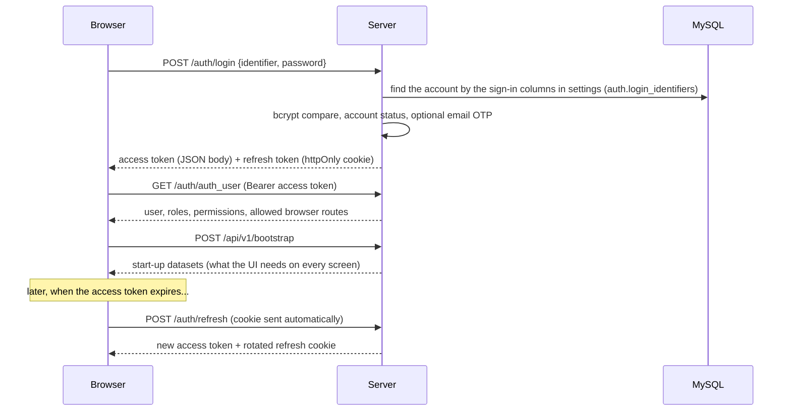
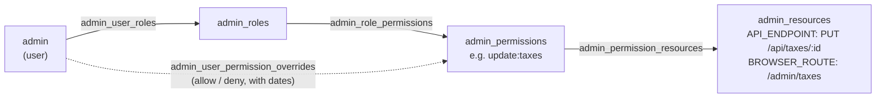

# How the framework works

This is the framework every business system is built on: an Express + MySQL server (`server/`) and a React + antd + Tailwind UI (`ui/`). This document follows one request from the browser to the database and back, then explains the main design decisions and their trade-offs.

Read it in order the first time. Each section names the files to open if you want to see the code.

---

## 1. The big picture

```mermaid
flowchart LR
    subgraph Browser["ui/ (React)"]
        Page["Page<br/>(MetadataTable, MetadataForm, hand-built screens)"]
        Hooks["Hooks + React Query<br/>(cache, refetch)"]
        DP["Data provider<br/>mysqlOrmProvider + apiClient"]
        Stores["Stores<br/>auth, resources, runtime values"]
    end
    subgraph Server["server/ (Express)"]
        MW["Middleware chain<br/>log → parse → CORS → helmet"]
        Auth["authMiddleWare<br/>who are you?"]
        Authz["authorization<br/>may you do this?"]
        Routes["Route classes<br/>(generic API, metadata, auth, admin)"]
        Services["Services<br/>BaseService, metadata*, auth*"]
        Model["Model / QueryBuilder"]
    end
    DB[("MySQL<br/>business tables +<br/>framework tables")]

    Page --> Hooks --> DP -->|"HTTPS + Bearer token"| MW --> Auth --> Authz --> Routes --> Services --> Model --> DB
    Stores -.-> Page
```



There are three ideas to hold on to:

1. **The database describes the system.** Users, roles, permissions, which URL needs which permission, which menu items exist, how forms and lists look, what loads at start-up, and settings all live in tables, not in code. The framework reads those tables at runtime.
2. **The server is the authority.** The UI hides what you can't do so the screen is tidy, but every rule is checked again on the server. Changing the browser code bypasses nothing.
3. **One generic API serves most tables.** `/api/:resources` reads and writes any table that isn't blocked. Metadata and permissions decide what each user may do with it, so most screens need no new server code.

---

## 2. The life of one request

Take a user who opens the Taxes page and saves an edit: `PUT /api/taxes/7`.

### In the browser

| Step | What happens | File |
|---|---|---|
| 1 | The page calls a hook, for example `useUpdate`, which calls the **data provider**. | `ui/src/core/hooks/data/` |
| 2 | The data provider turns "update taxes 7" into an HTTP call. | `ui/src/core/provider/mysqlOrmProvider.js` |
| 3 | `apiClient` (axios) attaches `Authorization: Bearer <access token>`. The token is kept in `sessionStorage`. | `ui/src/services/apiClient.js` |
| 4 | If the server answers **401** (access token expired), `apiClient` calls `/auth/refresh` once, queues any other requests that fail meanwhile, then replays them all with the new token. | same file |

### On the server

The order is set in `server/index.js`, and the order matters.

| Step | Layer | What it decides | File |
|---|---|---|---|
| 1 | `requestLogger` | Gives the request an id and logs it. | `core/middleware/requestLogger.js` |
| 2 | Parsers, rate limiter, CORS, helmet | Body size (100 kB, or 10 MB for CSV import), 500 requests per 15 min, allowed origins, security headers. | `index.js`, `core/config/origins.js` |
| 3 | **Public routes** (`AuthRoute`) | Login, refresh, password reset and OTP are registered **before** the auth check, so they work without a token. | `route/authRoute.js` |
| 4 | **`authMiddleWare`**: *who are you?* | Verifies the JWT signature and issuer, then compares the token's `token_version` with the database. If you changed your password or were signed out everywhere, old tokens stop working at once. | `core/middleware/authMiddleWare.js` |
| 5 | **`authorization`**: *may you do this?* | Loads your roles, permissions and allowed URLs (cached 5 min), checks the URL and method, then runs the ABAC policies. See section 4. | `core/middleware/authorization.js` |
| 6 | **Route class** | The matching handler. Routes are classes whose constructor registers their endpoints (`new BaseRoute(app)`). | `route/*.js` |
| 7 | `validateTable` | For the generic API only: the table exists, isn't blocked, and works out which columns *you* may read and write. Sensitive columns are always removed, and so are columns guarded by a permission you don't have. | `core/middleware/validateTable.js` |
| 8 | **`BaseService`** | Runs the operation. Writes pass through `validateRecordAgainstMetadata` first (section 5). | `core/lib/baseService.js` |
| 9 | **`Model` / QueryBuilder** | Builds parameterised SQL (`select().where().paginate()`) and runs it. Results go through `redactSensitiveData`. | `core/model/model.js`, `core/lib/queryBuilder.js` |
| 10 | Response or **error** | Success returns `{ status: "ok", message, data }`. Any thrown `AppError` (`ERR_ACCESS_DENIED`, `ERR_VALIDATION_FAILED`, …) is turned by `errorHandler` into a consistent JSON error with the right HTTP status, and is logged. | `shared/helpers/AppError.js`, `erroCodes.js`, `core/middleware/errorHandler.js` |

Handlers don't need `try/catch`: `express-async-errors` forwards a thrown error from an `async` handler to `errorHandler`.

---

## 3. Signing in



- **Two tokens.** The *access token* is short-lived and sent on every request. The *refresh token* lives in an `httpOnly`, `sameSite=strict` cookie, so page scripts can't read it, and it's only used to get a new access token. Both lifetimes are settings (`auth.jwt.access_ttl`, `auth.jwt.refresh_ttl`).
- **Configurable sign-in fields.** The setting `auth.login_identifiers` decides which columns of `admin` a user can sign in with (email, phone, staff number, …). Adding one needs no code change.
- Google sign-in and email OTP are optional and controlled by settings.
- **`token_version`** is the kill switch. Raising it in `admin_credentials` invalidates every token that user holds.

Files: `route/authRoute.js`, `core/lib/authService.js`, `ui/src/core/provider/mysqlOrmAuthProvider.js`, `ui/src/store/authStore.js`.

---

## 4. Authorization: who may do what

### The data model



- A **permission** is a name such as `update:taxes`.
- A **resource** is a concrete thing that needs a permission: an **API endpoint** (method + path pattern) or a **browser route** (a page, which also becomes a menu item).
- A user's permissions come from their **roles**. Per-user **overrides** can then add or remove single permissions, optionally only between two dates.
- **`superadmin` and `dev` are privileged.** They pass every permission check. They still go through the ABAC policies.

### The decision, step by step (`core/middleware/authorization.js`)

1. **Load the user's authority**: roles → permissions → overrides → allowed API resources. This is cached per user for 5 minutes. Changing a role or override clears that user's cache and pushes an event to their browser (section 7).
2. **Baseline check (RBAC).** The request is allowed if one of these holds:
   - it's a *core* endpoint every signed-in user needs (`/api/v1/bootstrap`, `/auth/auth_user`, `/api/v1/metadata/:table`, `/api/v1/lookups/:key`, `/api/v1/uploads/:table/:column`). Those endpoints run their own finer checks inside;
   - it's an endpoint a setting marks as open **and** it's on the code's short safety list. A setting alone can't open an endpoint;
   - the user is privileged;
   - one of the user's API resources matches the method and path.
3. **ABAC policies.** If the baseline passed, every registered policy is asked in turn. A policy can only **deny**, never grant. The core policies deny if there is no authenticated subject or the account isn't active. A project adds policies for rules like "a branch manager may only edit their own branch's records".
4. Denied → `ERR_ACCESS_DENIED` with the reason and which policy denied it. Allowed → the request continues with `req.permissions`, `req.roles` and `req.isPrivileged` attached for later layers.

**Pages** use the same data. `/auth/auth_user` returns the browser routes the user may open. The UI's `useRouteGuard` only lets you onto a page that's in that list, and the sidebar is built from it. Hiding a page is a convenience; the API behind it is still protected by step 2.

Files: `core/middleware/authorization.js`, `core/lib/authorityService.js`, `core/lib/authorizationPolicy.js`, `core/lib/abacEngine.js`, `core/lib/coreAbacPolicies.js`, `route/acessRoute.js` (managing roles and permissions), `ui/src/core/hooks/access/useRouteGuard.js`.

---

## 5. Data: the generic API, metadata and the forms

### The generic API (`route/baseRoute.js`)

| Endpoint | Does |
|---|---|
| `GET /api/:resources/table` | Paged, searchable, sortable, filterable list. The table page uses this. |
| `GET /api/:resources/:id` | One record. |
| `POST /api/:resources`, `/bulk` | Create one, or up to 500. |
| `PUT /api/:resources/:id` | Update. |
| `DELETE /api/:resources/:id` | Delete. |

Each endpoint is protected by its own API resource (`read:taxes`, `create:taxes`, …). `validateTable` and `BaseService` add the column rules. Credential, token and log tables are never served (`SENSITIVE_GENERIC_TABLES`).

### Metadata: describing a table once

A table can be **described**. Its description lives in four tables:

| Table | Holds |
|---|---|
| `metadata_tables` | One row per table: label, singular label, title column, default sort, search columns, form layout (modal/drawer/page), columns, sections, stepper. |
| `tables_metadata` | One row per field: label, type, in the form, in the list, required, editable, read-only, section, width, and a `config` JSON (options, lookup, placeholder, help text, default, rules, show-when, required-when, min/max, currency, accepted files, read/write permissions). |
| `metadata_lookups` | Where a lookup field's choices come from (source table, value column, label column, filter, sort, which field it depends on, permission needed). The browser only ever sends a lookup **key**, never SQL. |
| `metadata_versions` | Every saved definition with a readable list of what changed and who changed it. |

**The same description drives three things:**

1. **The UI.** `MetadataTable` and `MetadataForm` build the list and the form from `GET /api/v1/metadata/:table`. Field types come from a registry (`ui/src/core/metadata/fieldTypes.jsx`), so a project can add its own with `registerFieldType`. Layouts work the same way (`formLayouts.js`, built-in `steps`).
2. **The server's checks.** `validateRecordAgainstMetadata` (`core/lib/metadataSchema.js`) builds a zod schema from the fields and checks every generic write:
   - types are coerced and unknown columns dropped;
   - required, rules, options, show-when/required-when and lookup values are all checked;
   - read-only and primary-key fields are never written, and non-editable fields only on create;
   - **for a user's request**, fields hidden from the form are dropped, and fields guarded by `writePermission` are rejected without that permission.
3. **What each user may see.** Fields guarded by `readPermission` are removed from records, filters, search and the form/list metadata for users without it.

Tables that aren't described still work through the generic API. They only get the permission checks, no field rules.

**The builder** (Settings › Data model, permission `manage:metadata`) edits all of this in the browser: describe a table, design its form and list with a live preview, edit lookups, see versions and restore one, export and import definitions, import records from CSV and write a migration for a new table. The builder never changes the database schema itself; a new table becomes a migration file.

Files: `core/lib/metadataService.js`, `metadataSchema.js`, `metadataAdminService.js`, `metadataScaffold.js`, `route/MetadataRoute.js`, `route/MetadataAdminRoute.js`, `ui/src/components/metadata/`, `ui/src/pages/settings/dataModel/`.

---

## 6. Start-up data and settings

- **Bootstrap registry.** What the UI loads right after sign-in is defined in `framework_bootstrap_profiles` and `framework_bootstrap_datasets`: which tables, columns, filters, sort and maximum rows, optionally per environment and per permission. The browser asks for a *profile* (`authenticated_startup`) and never names tables itself. Results land in the runtime values store (`ui/src/store/values-store`).
- **System settings.** `SettingsManager` (`core/lib/systemSettings.js`) reads key/value settings from the database and caches them in memory: token lifetimes, sign-in identifiers, open endpoints, OTP and Google switches, backup schedule. Appearance (colours, radius, fonts, dark mode) is a UI setting with its own route (`route/UiSettingsRoute.js`).

---

## 7. The UI shell

`ui/src/main.jsx` wraps the app in this provider stack, from the outside in:

```
GoogleOAuthProvider → BrowserRouter → ThemeProvider → antd App
  → FrameworkProvider(dataProvider, authProvider, resources)
      → SocketProvider → App (routes)
```

| Piece | Job | File |
|---|---|---|
| `FrameworkProvider` | Holds the data provider, auth provider, access checks and resource registry; runs bootstrap after sign-in; sets up React Query. | `core/provider/FrameworkProvider.jsx` |
| **Data provider** | The only thing that knows the API's URL shapes. Pages call `getList`, `getOne`, `create`, `update`, `deleteOne`, `custom`, never axios directly. A different backend would mean a different data provider. | `core/provider/mysqlOrmProvider.js`, `DataProvider.js` |
| **Auth provider** | Login, logout, refresh, current user. | `core/provider/mysqlOrmAuthProvider.js` |
| **Stores** (zustand) | `authStore` (user, roles, permissions), `ResourceProvider` (browser routes and the menu), `values-store` (bootstrap data). | `store/`, `core/provider/` |
| **React Query** | Caches every server read (`['metadata', table]`, `['auth_user']`, …) and refetches after writes. | `core/queryClient.js`, `core/queryKeys.js` |
| **Access hooks** | `useCan('update:taxes')` hides buttons the user can't use. Cosmetic only; the server decides. | `core/hooks/access/` |
| **Layout and routes** | `AppLayout` (sidebar from browser routes, header, profile) plus the route guard. Pages are lazy-loaded in `App.jsx`. | `components/Layout/`, `App.jsx` |

### Live updates

Two channels push from the server to the browser:

- **Authority events** (Server-Sent Events, `/auth/access-events`). When an admin changes your role, permissions or account status, the server publishes an event. Your browser then re-fetches `auth_user` and bootstrap, so menus and buttons update without signing in again. Files: `core/lib/authorizationEvents.js`, `ui/src/core/hooks/auth/useAuthorizationEvents.js`.
- **Socket.IO** (`core/realtime/socketServer.js`, `ui/src/core/realtime/SocketProvider.jsx`). An authenticated socket for project features such as notifications or live dashboards.

---

## 8. Supporting systems

| System | How it works | Files |
|---|---|---|
| **Migrations** | Numbered SQL files in `server/resources/migrations` (`001_…sql`). `npm run migrate` applies the ones not yet recorded, refuses duplicate numbers and stores a checksum, so an edited old migration is noticed. | `scripts/run-migration.js` |
| **Backups** | Manual and scheduled database backups with history and a SHA-256 checksum. The schedule is checked every 5 minutes, so a backup missed while the server was off runs soon after it starts. | `core/lib/databaseBackupService.js`, `backupHistoryService.js`, `route/BackupRoute.js` |
| **Logging** | Winston (optionally Logtail): `logger.app`, `logger.error`, `logger.security` (sign-ins, permission changes, metadata saves), plus request logs. | `shared/helpers/logger.js` |
| **Uploads** | Field uploads go to `/api/v1/uploads/:table/:column`. The field's metadata decides the allowed types and size, and the file's real content type is checked. | `core/lib/uploadServices.js`, `metadataService.uploadFieldFile` |
| **Tests** | Jest on the server (authorization, ABAC, generic CRUD, metadata); Vitest on the UI (metadata runtime, record form). | `server/tests/`, `ui/src/**/*.test.jsx` |

---

## 9. Design decisions and why

| Decision | Why | Trade-off |
|---|---|---|
| **Permissions map to URL patterns in the database** (`admin_resources`), not to checks written in each handler. | One place to see and change who can call what. New endpoints are protected by adding rows, and an admin can audit everything from the Resources page. | A new endpoint is denied (except for privileged roles) until its resource row exists. That's safe, but easy to forget; migrations should add the rows. |
| **RBAC first, then deny-only ABAC.** | Roles answer "may this kind of user call this endpoint?" Policies add conditions like ownership, branch or account status. Deny-only means a buggy policy can never *grant* access, and a policy that throws counts as a denial. | A rule that would *grant* access by attribute has to be modelled as a permission instead. |
| **A generic CRUD API plus metadata, instead of a route per table.** | Most business tables are plain records. One audited path for all of them means fewer bugs and fewer endpoints to protect. Hand-written routes stay available for real workflows (approvals, invoicing). | Complex workflows still need code; metadata isn't meant to express them. |
| **Metadata is checked on the server, not only in the form.** | The browser can be bypassed. One description gives the form *and* the API the same rules, so they can't drift apart. | Every generic write costs a couple of extra metadata queries. |
| **Lookups are named keys, never SQL from the browser.** | The old design sent SQL text to the browser and parsed it, which was risky and fragile. A key means the server decides which table and columns are read, and can require a permission. | A new dropdown source needs a lookup row (the builder makes that easy). |
| **The UI never talks to the API directly; it goes through a data provider.** | Pages describe *what* they want, not *how* to fetch it. URL conventions, tokens and errors live in one file, and React Query caching works the same everywhere. | One more layer to learn. |
| **Short access token in `sessionStorage`, refresh token in an `httpOnly` cookie**, plus `token_version`. | Page scripts can't steal the long-lived refresh token, and an access token is only useful briefly. `token_version` signs a user out everywhere at once. | A script running in the page could still read the short access token, so the content security headers (helmet) matter. |
| **Configuration lives in the database** (sign-in fields, open endpoints, bootstrap, appearance, metadata). | Behaviour changes without deploying code, and each client install can differ. | The database becomes part of the configuration and has to be migrated and backed up; that's why migrations and backups are built in. |
| **Permissions cached 5 minutes, cleared on change, pushed to the browser.** | Without the cache, each request would run several queries just for authorization. Clearing it on change keeps it correct in practice. | With several server processes, a change clears only the cache in the process that handled it; the others catch up within 5 minutes. A shared cache (Redis) would be needed when scaling out. |
| **Schema changes go through migration files, never the browser.** | Schema changes are reviewed, versioned, repeatable on every install and reversible from backups. | Adding a table takes a deploy step, not just a click. |

---

## 10. Known weak spots

Be honest about these when explaining the framework. They are also on the clean-up list in the packaging plan (`docs/plans/framework-packaging.md`).

- The "Dashboard" page (`/admin/home`) still shows a legacy playground (`pages/Test.jsx`); the framework has no real home page yet.
- The browser route `/admin/settings/api` is registered but has no page.
- The privileged role names (`superadmin`, `dev`) live in one place on each side (`authorizationPolicy.js`, `AccessProvider.js`); both must change together.
- The permission cache is per process (see section 9).

Fixed in packaging phase 1 (2026-11-24): leftover business code removed, `server/index.js` tidied, one list of sensitive tables and columns (`core/config/sensitiveData.js`), start-up no longer loads every field of every table.
